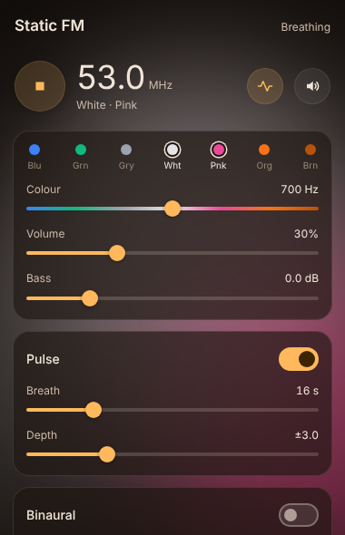

# Static FM

Play seven-colour stereo noise with binaural tones, an adjustable pulse and a sleep timer in your Obsidian sidebar.

Static FM tunes between seven colours of noise (blue, green, grey, white, pink, orange and brown) from one dial. The controls sit on glass cards over soft colour glows that drift slowly and take on the colour of the noise.

## Features

- **Noise:** two independent generators for a wide stereo field. One colour slider moves from bright blue noise down to deep brown, with volume, bass boost (−3 to +12 dB) and mute.
- **Pulse:** slowly breathes the colour back and forth around where you left it. You can set the breath length (4–60 s) and depth.
- **Binaural tones:** Delta (2 Hz), Theta (6 Hz), Alpha (10 Hz), Beta (18 Hz), Gamma (40 Hz) or Custom (beat 0.5–40 Hz, tone 60–500 Hz), with a mix level. Use headphones.
- **Sleep timer:** 15, 30, 60 or 90 minutes, fading out gently at the end.
- **Status bar:** shows the frequency, beat and time left while playing. Click it to stop.
- **Static Aurora theme:** with the [Static Aurora](https://github.com/AshOtis/aurora-theme) theme installed, the theme's glows take on the colours of your noise when you press play. They stay when you pause. Turn this off in settings with **Colour the Static Aurora theme**.
- **Takes turns:** pressing play pauses my other players (Aurora MP3, Hi-Fi Tuner), and they stop Static FM. Turn on **Play alongside other players** to mix them.
- **Commands:** start/stop, pulse, mute, binaural on/off, each preset and each timer. Assign your own hotkeys in **Settings → Hotkeys**.

## Usage

1. Click the waves icon in the left ribbon, or run **Static FM: Open player** from the command palette.
2. Press the round play button. Choose a colour with the dots or the colour slider.
3. Turn on Pulse, binaural tones or a sleep timer as you like.

In **Settings → Static FM** you can turn off the drifting background and hide the status bar item.

## Privacy

Static FM makes no network requests and collects no data. All sound is generated on your computer with the Web Audio API. Settings are saved in the plugin's own `data.json` in your vault.

## Desktop only

Static FM is marked desktop only, because background audio on mobile is unreliable.

## Building from source

The plugin has no dependencies. `src/` holds the readable source, and `python3 build.py` writes `main.js`, `styles.css` and `manifest.json` to `dist/`.

## Support

If Static FM helps you focus or sleep, you can [buy me a coffee](https://buymeacoffee.com/ashotis). Found a bug or have an idea? [Open an issue](https://github.com/AshOtis/static-fm/issues). It's the best way to reach me, and every report gets read.

## License

[MIT](LICENSE) © AshOtis
